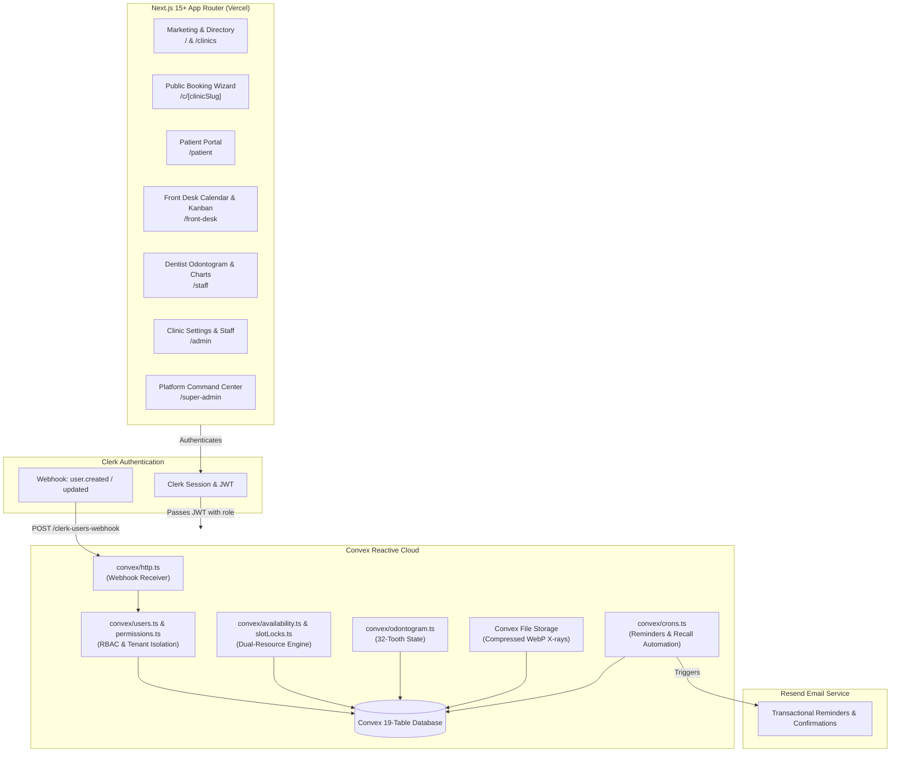

# Smile Dental Scheduling System 🦷

[](https://nextjs.org/)
[](https://www.convex.dev/)
[](https://clerk.com/)
[](https://tailwindcss.com/)
[](https://ui.shadcn.com/)
[](https://resend.com/)
[](LICENSE)
[](#zero-cost-architecture--free-tier-guardrails)

**Smile** is a modern, multi-tenant dental practice management and real-time patient appointment scheduling SaaS. Built from the ground up for modern dental clinics, it manages dentists, operatories, complex treatments, and patient workflows within a reactive, unified application.

The platform is engineered to run on a **strictly $0.00/month infrastructure cost** by leveraging the generous free tiers of Next.js (Vercel), Convex, Clerk, and Resend without compromising on enterprise-grade security, ACID transactional integrity, or real-time performance.

---

## Table of Contents

- [Why Smile? The Dental Scheduling Problem](#why-smile-the-dental-scheduling-problem)
- [System Portals & User Roles](#system-portals--user-roles)
- [Key Features](#key-features)
- [System Architecture](#system-architecture)
- [Application Route Map](#application-route-map)
- [Quick Start Guide](#quick-start-guide)
  - [Prerequisites](#prerequisites)
  - [1. Clone & Install](#1-clone--install)
  - [2. Configure Environment Variables](#2-configure-environment-variables)
  - [3. Start Convex Backend](#3-start-convex-backend)
  - [4. Configure Clerk Authentication](#4-configure-clerk-authentication)
  - [5. Seed Subscription Plans](#5-seed-subscription-plans)
  - [6. Start Next.js Frontend](#6-start-nextjs-frontend)
  - [7. Access Super Admin](#7-access-super-admin)
- [Verification & Quality Checks](#verification--quality-checks)
- [Zero-Cost Architecture & Free-Tier Guardrails](#zero-cost-architecture--free-tier-guardrails)
- [Specification Documents](#specification-documents)

---

## Why Smile? The Dental Scheduling Problem

Standard booking systems treat appointments as simple 1-on-1 calendar events (one customer + one staff member). **Dental practice scheduling is fundamentally different and significantly more complex:**

1. **Dual-Resource Requirement**: A dental procedure cannot happen with just a dentist; it also requires a specific **Operatory Chair** equipped with clinical equipment. If either the dentist OR the operatory chair is booked, the time slot is invalid.
2. **Turnaround & Sterilization Buffers**: Operatory chairs require mandatory sterilization and tool resetting (e.g., 10–15 minutes) between patients before the next treatment can begin.
3. **Race Conditions During Booking**: When multiple patients browse appointments at the same time, traditional systems allow double-booking. Smile introduces **5-minute reactive slot locks** that temporarily reserve slots in real time across all browsers.
4. **Visual Clinical Charting**: Dentists need direct access to an electronic dental record (Odontogram) mapping all 32 adult and 20 primary teeth with surface-level precision (Occlusal, Mesial, Distal, Buccal, Lingual).

Smile solves all four challenges natively using **Convex's reactive ACID transaction engine**.

---

## System Portals & User Roles

Smile provides five tailored web experiences, routed automatically upon authentication based on the user's role:

| Role | Portal Route | Primary Capabilities |
| :--- | :--- | :--- |
| 👑 **Super Admin** | `/super-admin` | Platform owner command center: provision clinics, manage subscription tiers (Trial, Starter, Pro), record manual payments (GCash, Bank Transfer, Cash), view MRR/storage gauges, and audit platform events. |
| 🏥 **Clinic Admin** | `/admin` | Practice administration: configure clinic profile and operating hours, manage dentists and weekly shift schedules, configure operatory chairs, customize services with turnaround buffers, and review clinic analytics. |
| 📋 **Front Desk / Receptionist** | `/front-desk` | Reception command center: live interactive multi-view calendar (`react-big-calendar`), drag-and-drop check-in queue (Scheduled → Confirmed → Arrived → In-Chair → Completed), walk-in bookings, and patient intake. |
| 🩺 **Dentist / Clinical Staff** | `/staff` | Clinical treatment workspace: today's patient queue, digital medical histories, interactive 32-tooth SVG Odontogram for tooth-by-tooth diagnosis and treatment tracking, and client-compressed dental X-ray gallery. |
| 🦷 **Patient / Family** | `/c/[clinicSlug]` & `/patient` | Frictionless patient experience: branded clinic booking wizard, real-time slot selection, dependent family member management, appointment rescheduling, and digital health history intake. |

---

## Key Features

### ⚡ Dual-Resource Scheduling Engine
- Evaluates **Dentist shifts + Operatory Chair availability + Procedure Turnaround buffers** in a single ACID query.
- Eliminates provider and chair double-booking permanently.
- Honors dentist time-off, holidays, and variable clinic hours.

### 🔒 5-Minute Reactive Slot Locking
- Clicking a slot temporarily locks the Dentist + Chair pair for **5 minutes**.
- Synchronized instantaneously to all other browsing patients via Convex WebSockets (the slot appears locked or grayed out in real-time without reloading).
- Locks expire automatically via scheduled background functions if booking is abandoned.

### 🦷 Interactive 32-Tooth SVG Odontogram
- Full anatomical tooth chart supporting both **Adult (Permanent, 32 teeth)** and **Pediatric (Deciduous, 20 teeth)** views.
- Five clickable surfaces per tooth: **Occlusal/Incisal, Mesial, Distal, Buccal/Facial, and Lingual**.
- Visual color-coded condition mapping: *Healthy, Caries/Cavity, Existing Restoration, Crown, Root Canal, Missing, Extraction Indicated, and Implant*.
- Per-tooth clinical notes and historical treatment timeline.

### 🩻 Client-Compressed X-Ray & File Vault
- Automatically compresses high-resolution intraoral photos and dental X-rays to **WebP format under 500 KB** directly inside the patient's browser before upload.
- Stores files safely in Convex File Storage while staying strictly within free-tier storage limits.

### ⏰ Automated Recalls & Transactional Notifications
- Integrated transactional email engine powered by **Resend**.
- Instant booking confirmations with calendar invite (.ics) generation.
- Automated daily crons for **24-hour appointment reminders** and **6-month hygiene recall checkups**.

### 🏢 Strict Multi-Tenant Isolation
- Every clinic's operational records (`appointments`, `patients`, `dentists`, `chairs`, `toothRecords`, `clinicalFiles`) are strictly isolated with compound indexes partitioned by `clinicId`.
- No clinic can ever view or query another clinic's data.

---

## System Architecture



---

## Application Route Map

| Path | Purpose | Access Control |
| :--- | :--- | :--- |
| `/` | Marketing landing page with interactive scheduler preview & pricing | Public |
| `/clinics` | Directory of clinics registered on the platform | Public |
| `/c/[clinicSlug]` | Branded 4-step booking wizard for a specific clinic | Public |
| `/sign-in` & `/sign-up` | Clerk-powered authentication interfaces | Public |
| `/post-login` | Intelligent router redirecting users to their role portal | Authenticated |
| `/patient` | Patient portal: view appointments, dependents, health history | Patient, Super Admin |
| `/front-desk` | Multi-view calendar, check-in Kanban queue, walk-in modal | Receptionist, Clinic Admin, Super Admin |
| `/staff` | Clinical chair queue, odontogram charting, X-ray uploads | Dentist, Clinic Admin, Super Admin |
| `/admin` | Clinic administration: dentists, chairs, services, reports | Clinic Admin, Super Admin |
| `/super-admin` | Multi-clinic provisioning, subscription billing, analytics | Super Admin only |

---

## Quick Start Guide

Follow these steps to run the complete system locally.

### Prerequisites
- **Node.js**: `v20.x` or higher
- **Package Manager**: `npm` (v10+)
- Free accounts on:
  - [Convex](https://www.convex.dev/) (Reactive database & backend)
  - [Clerk](https://clerk.com/) (Authentication)
  - [Resend](https://resend.com/) (Transactional emails)

---

### 1. Clone & Install

```bash
git clone https://github.com/your-username/smile-dental-scheduling-system.git
cd smile-dental-scheduling-system
npm install
```

---

### 2. Configure Environment Variables

Create a local `.env.local` file by copying the template:

```bash
cp .env.example .env.local
```

Populate the required keys:

```ini
# Next.js & Client Secrets (.env.local)
NEXT_PUBLIC_CONVEX_URL=https://<your-convex-deployment>.convex.cloud
NEXT_PUBLIC_CLERK_PUBLISHABLE_KEY=pk_test_...
CLERK_SECRET_KEY=sk_test_...
NEXT_PUBLIC_APP_URL=http://localhost:3000

# Super Admin Account (Email that automatically gets super_admin role)
SUPER_ADMIN_EMAIL=your-email@example.com
```

Configure Convex server-side secrets in your **[Convex Dashboard](https://dashboard.convex.dev/) → Project Settings → Environment Variables**:

| Variable Name | Purpose | Example / Source |
| :--- | :--- | :--- |
| `CLERK_JWT_ISSUER_DOMAIN` | Clerk JWT Issuer for Convex authentication | `https://<your-clerk-subdomain>.clerk.accounts.dev` |
| `CLERK_WEBHOOK_SECRET` | Svix signing secret for Clerk webhooks | `whsec_...` (from Clerk Webhook dashboard) |
| `SUPER_ADMIN_EMAIL` | Grants Super Admin access to matching email | `your-email@example.com` |
| `RESEND_API_KEY` | API key for transactional emails | `re_...` (from Resend dashboard) |
| `RESEND_FROM_EMAIL` | Sender address for transactional emails | `Smile Dental <onboarding@resend.dev>` |
| `CLERK_SECRET_KEY` | *(Optional)* Allows Convex webhook to mirror roles to Clerk | `sk_test_...` |

---

### 3. Start Convex Backend

Initialize your Convex project and start the background sync process:

```bash
npx convex dev
```

*Keep this terminal running. It compiles your schema and backend functions in real time.*

---

### 4. Configure Clerk Authentication

1. **Create a JWT Template for Convex**:
   - In your [Clerk Dashboard](https://dashboard.clerk.com/), go to **Configure → JWT Templates**.
   - Click **New Template** and select **Convex**.
   - Name it `convex` (default).
   - Copy the **Issuer URL** and set it as `CLERK_JWT_ISSUER_DOMAIN` in Convex Dashboard.

2. **Configure the Clerk Webhook**:
   - Go to **Configure → Webhooks** in Clerk.
   - Click **Add Endpoint**.
   - URL: `https://<your-convex-deployment>.convex.site/clerk-users-webhook`
   - Subscribe to events: `user.created`, `user.updated`, `user.deleted`.
   - Copy the **Signing Secret** (`whsec_...`) and set it as `CLERK_WEBHOOK_SECRET` in Convex.

---

### 5. Seed Subscription Plans

Run the idempotent platform seed mutation to populate standard tiers (`Trial`, `Starter`, `Pro`):

```bash
npx convex run seed:initializePlatform
```

---

### 6. Start Next.js Frontend

In a separate terminal, launch the Next.js development server:

```bash
npm run dev
```

Open [http://localhost:3000](http://localhost:3000) in your browser.

---

### 7. Access Super Admin

1. Sign up on the platform using the email specified in `SUPER_ADMIN_EMAIL`.
2. The webhook and auth flow will automatically assign your account the `super_admin` role.
3. Visit [http://localhost:3000/super-admin](http://localhost:3000/super-admin) to access the platform command center and provision your first dental clinic!

---

## Verification & Quality Checks

The codebase includes an automated security and hardening verification script enforcing multi-tenant isolation, index rules, and scheduling math:

```bash
# Run the 7-point hardening test suite
npm run verify

# Verify strict TypeScript type compliance (zero explicit `any`)
npx tsc --noEmit

# Run ESLint checks
npm run lint

# Test production build
npm run build
```

### What `npm run verify` Checks:
- ✅ **Zero unindexed `.filter()` scans** across all Convex database queries.
- ✅ **Strict TypeScript compliance** (zero `any` or `as any` in application code).
- ✅ **Super Admin isolation** (`requireSuperAdmin` guard enforced on all platform routes).
- ✅ **Clinic isolation & quota gates** (`requireClinicAccess` and `assertClinicCanWrite` enforced).
- ✅ **Dual-resource scheduling math** (validates sterilization buffer overlapping logic).
- ✅ **Compound indexes** (`clinicId` as the leading index on all 11 operational tables).
- ✅ **Daily automation crons** registered in `convex/crons.ts`.

---

## Zero-Cost Architecture & Free-Tier Guardrails

Smile is intentionally architected to stay comfortably within the free tiers of its cloud providers:

| Service | Free-Tier Budget | Smile Optimization & Guardrail |
| :--- | :--- | :--- |
| **Convex Database** | 0.5 GB storage, 1M calls/mo | All queries use strict compound indexes; zero full-table scans. |
| **Convex File Storage** | 1.0 GB storage, 1 GB/mo bandwidth | High-res X-rays and photos are client-compressed to WebP under 500 KB before upload. |
| **Clerk Auth** | 10,000 Monthly Active Users | Roles and `clinicId` are mirrored in Convex `users`, avoiding expensive B2B Organization add-ons. |
| **Resend** | 3,000 emails/month (100/day) | Email quota tracked per tenant; non-critical notifications batched in daily digests. |
| **Vercel** | Hobby Plan (Free) | All heavy mutations and cron automations run on Convex; Vercel handles pure SSR/UI rendering. |

---

## Specification Documents

For deep-dive technical specifications, consult the dedicated architecture documentation:

- [`agents.md`](./agents.md) — Master AI agent constitution, zero-cost guardrails, multi-tenant security laws, and sub-agent routing.
- [`architecture.md`](./architecture.md) — System topology, Clerk + Convex RBAC flow, tenant isolation, and repository map.
- [`database_schema.md`](./database_schema.md) — Complete 19-table Convex schema (`convex/schema.ts`), compound indexes, and seed requirements.
- [`super_admin_spec.md`](./super_admin_spec.md) — Super Admin command center, multi-clinic provisioning, manual SaaS billing ledger, and analytics.
- [`clinic_scheduling_spec.md`](./clinic_scheduling_spec.md) — Dual-resource slot engine, 5-minute slot locking, front-desk Kanban, and 32-tooth SVG Odontogram.
- [`implementation_roadmap.md`](./implementation_roadmap.md) — Phased execution roadmap, environment variable setup, and pre-release QA checklist.

---

## License

This project is open-source and available under the [MIT License](LICENSE).
